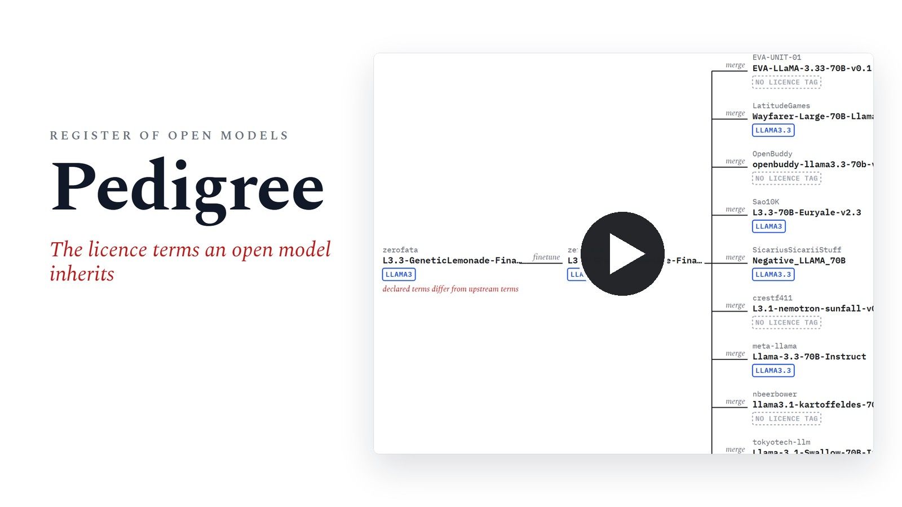
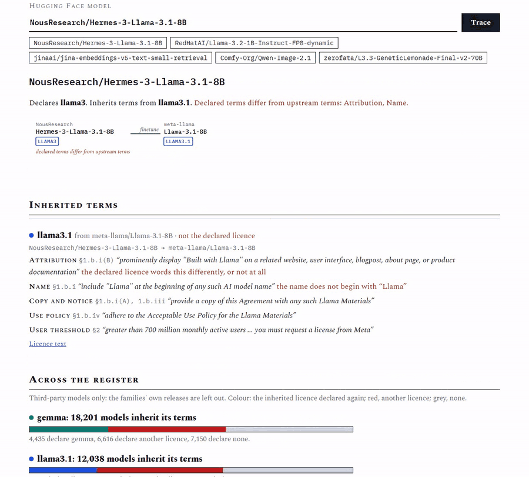
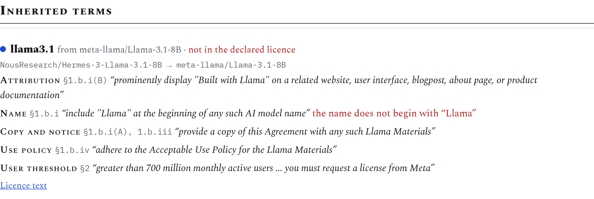

# Pedigree

**Pedigree tells you which licence terms an open model inherits from the models it was built on, before you or your coding agent download it.**

[](https://github.com/Marc-Dvci/pedigree/actions/workflows/tests.yml)
[](#run-it)
[](https://github.com/Marc-Dvci/pedigree/actions/workflows/codeql.yml)
[](LICENSE)
[](https://marc-dvci.github.io/pedigree/)

[](https://www.youtube.com/watch?v={{VIDEO_ID}})

**[Watch the film](https://www.youtube.com/watch?v={{VIDEO_ID}})** · **[Open the live page](https://marc-dvci.github.io/pedigree/)**

I led AI use cases for an internal-audit function, and the first question about any open model was what we were allowed to do with it.

| Live page | Built with | Store | Headline result |
|---|---|---|---|
| [Open it](https://marc-dvci.github.io/pedigree/) (Relate runs in the tab) | Relate by Neo4j 1.0.1: Python, CLI, MCP, WebAssembly | Single file, [`pedigree.rl`](pedigree.rl) | 12,038 models inherit Llama 3.1 terms; 2,516 declare them |

[For judges](#for-judges) · [See it work](#see-it-work) · [Use case](#use-case) · [How it uses Relate](#how-it-uses-relate) · [Agents](#agents) · [Results](#results) · [Run it](#run-it) · [Where the data lives](#where-the-data-lives)

## For judges

| Criterion | Where it is answered |
|---|---|
| Relate and connected context | [How it uses Relate](#how-it-uses-relate): inherited terms are a variable-length walk up the family tree in Cypher ([`pedigree/checks.py`](pedigree/checks.py)), over 213,928 models in one `.rl` file |
| Functionality and completeness | [See it work](#see-it-work), [Run it](#run-it): command line, MCP server, a pre-download hook for coding agents, browser page, Docker images; 41 tests and 8 browser tests |
| Usefulness | [Use case](#use-case), [Results](#results): figures on the whole Hugging Face snapshot |
| Documentation and reproducibility | [Run it](#run-it) needs no keys; `python -m pedigree build --revision <commit>` rebuilds the graph from the pinned snapshot |
| Creativity | Licence clauses as graph nodes that flow down `DERIVED_FROM` edges, checked at the moment an agent is about to download |
| AI and agentic capabilities | [Agents](#agents): a hook that stops a coding agent before a download, MCP tools, a skill, and a measured comparison of an agent with and without the graph |

## See it work



The page runs Relate 1.0.1 in the browser tab, compiled to WebAssembly, on a slice of the graph: the most downloaded
models under each licence with obligations, with all their ancestors (1,280 models). It runs the same Cypher as the
command line, and a [parity check](web/test/parity.mjs) proves the two give the same answers.


A merge carries every parent's terms. This one declares `llama3`; its family tree also carries Llama 3.1 and Llama
3.3, whose attribution and naming clauses are worded differently, and its name does not begin with "Llama 3" as the
Llama 3 licence asks.



A coding agent about to download a model hears about its pedigree first. The repository's Claude Code hook runs before
every command and file edit:

```text
$ hf download NousResearch/Hermes-3-Llama-3.1-8B
Pedigree: check these inherited licence terms before using the model.

NousResearch/Hermes-3-Llama-3.1-8B: declares llama3
  Inherits llama3.1 from meta-llama/Llama-3.1-8B
    path: NousResearch/Hermes-3-Llama-3.1-8B -> meta-llama/Llama-3.1-8B
    attribution: clause 1.b.i(B): prominently display "Built with Llama" on a related website, user interface, ...
    naming: clause 1.b.i: include "Llama" at the beginning of any such AI model name
    ...
  Declared terms differ from upstream terms: attribution, naming
  Name: llama3.1 clause 1.b.i asks derivative models to begin with 'Llama'
```

## Use case

An open model on Hugging Face is rarely an original. It is a fine-tune of an instruct model, quantised by someone
else, merged with a third model. Its card shows one licence. The terms that travel with it come from every model it was
built on: Llama 3.1 asks anyone who distributes a derivative to display "Built with Llama" and to begin a derived model's name with "Llama"; Gemma's
terms carry its prohibited-use policy downstream; Qwen's research licence allows research and evaluation only.

The engineer adding `from_pretrained("...")` to a product, or the coding agent writing that line, sees the card. On the
snapshot of the Hub this repository holds, 12,038 third-party models inherit Llama 3.1's terms, and 2,516 of them
declare that licence. 4,825 declare none.

Pedigree answers one question from the graph, at the moment it matters: **which licence terms does this model inherit,
from which ancestor, by which path, under which clause?**

## How it uses Relate

- **Mode:** single file, [`pedigree.rl`](pedigree.rl).
- **Why this mode:** the lineage graph is rebuilt from a daily public snapshot of the Hub, so it ships as one versioned file that a coding-agent hook, CI or a notebook opens read-only, with nothing to install or run.
- **What the graph models:**

```text
(:Model {id, licence, downloads})-[:DERIVED_FROM {relation}]->(:Model)     finetune | adapter | merge | quantized
(:Model)-[:DECLARES]->(:Licence {id, name})
(:Licence)-[:REQUIRES]->(:Obligation {kind, clause, text, source})         attribution, naming, notice, use policy,
                                                                           non-commercial, user threshold
(:Snapshot {dataset, revision, rows})
```

## How it works


1. **Lineage.** The Hub tags every model whose card names a base model: `base_model:finetune:<id>`, `adapter`, `merge`
   and `quantized`. [`lineage.py`](pedigree/lineage.py) reads those tags from the 914,842 cards of the pinned snapshot,
   resolves ids written with other casing, drops the 1,235 cards that name the model as its own base, and keeps every
   model below the five families' own releases. The snapshot leaves out gated repositories, so the families' 775 gated
   models come from the Hub API.
2. **Licences.** `license:<id>` gives the declared licence; for `license:other`, the family models' cards give the
   name (`qwen-research`, `mrl`, `deepseek`...). Each licence links to the obligations it passes to derivatives,
   quoted from its text ([`sources/obligations.csv`](sources/obligations.csv)).
3. **One file.** [`build.py`](pedigree/build.py) writes the graph with Relate's Python binding, and `relate clone`
   compacts it into `pedigree.rl`, 16.5 MB.
4. **Checks.** A model's inherited terms are one Cypher statement: `ANY SHORTEST` paths up `DERIVED_FROM` to each
   ancestor, then the ancestor's licence and its obligations, keeping the nearest ancestor for each. Over 24 checks, the
   median took 0.5 milliseconds and the slowest 2.6. Shortest paths matter here: one dense family of merges has 426 descendants and far more paths.

```cypher
// Every obligation a model inherits, from its nearest ancestor (pedigree/checks.py)
MATCH p = ANY SHORTEST (m:Model {id: $id})-[:DERIVED_FROM]->{1,30}(a:Model)
MATCH (a)-[:DECLARES]->(l:Licence)-[:REQUIRES]->(o:Obligation)
WITH l, o, a, [n IN nodes(p) | n.id] AS chain ORDER BY size(chain), a.id
RETURN l.id AS licence, o.kind AS kind, collect({ancestor: a.id, chain: chain, clause: o.clause, text: o.text})[0] AS nearest
```

## Agents

| Piece | What the agent gets |
|---|---|
| Pre-download hook ([`.claude/settings.json`](.claude/settings.json)) | Before any Bash command or file edit, [`detect.py`](pedigree/detect.py) finds the model ids it would download (`from_pretrained`, `pipeline`, `hf download`, `huggingface-cli download`, `snapshot_download`, `vllm serve`, `ollama run hf.co/...`, `-hf`) and returns their inherited terms to the agent |
| MCP server, `python -m pedigree mcp` ([`.mcp.json`](.mcp.json)) | `check_model`, `find_models`, `get_schema` and a read-only `read_cypher` |
| Agent skill ([`.claude/skills/pedigree/SKILL.md`](.claude/skills/pedigree/SKILL.md), [`AGENTS.md`](AGENTS.md)) | When to check a model, and the rule to quote the clause the tool returns |

**Agent evaluation.** Qwen 3.8 Flash answered the same question about 21 real models, three times each: which
licences' terms does this model inherit from the models it was built on? The models were picked by a fixed rule (under
each licence with obligations, the two most downloaded third-party models that declare a different licence), and the
answers were taken from the graph and committed at [`057ce1b`](https://github.com/Marc-Dvci/pedigree/commit/057ce1b),
before the model ran ([`experiments/agent_eval.py`](experiments/agent_eval.py),
[`evidence/agent-eval/`](evidence/agent-eval/)).

| How the model answered | Correct | Median seconds per answer | Output tokens per answer |
|---|---|---|---|
| Reading the model's own Hugging Face card | 27 of 63 | 63 | 9,003 |
| Calling the Pedigree tools on Relate | **63 of 63** | 27 | 766 |

Five of the models carry more than one licence in their family tree, such as a Llama 3.3 quantisation that also
inherits Llama 3.1's terms. Reading the card, the model got 0 of their 15 answers right; with the tools, 15 of 15. A
licence written out in full counts as its id when grading (`mistral-research-license` for `mrl`).

## Results

Figures on the pinned snapshot, for third-party models (the five families' own releases are left out). They are in
[`evidence/stats.json`](evidence/stats.json), computed in Cypher by [`stats.py`](pedigree/stats.py) in 2.3 seconds.

| Licence | Models that inherit its terms | Declare the same licence | Declare another | Declare none |
|---|---|---|---|---|
| Gemma | 18,201 | 4,435 | 6,616 | 7,150 |
| Llama 3.1 | 12,038 | 2,516 | 4,697 | 4,825 |
| Llama 3.2 | 8,598 | 2,415 | 2,490 | 3,693 |
| Llama 3 | 4,336 | 1,858 | 1,231 | 1,247 |
| Llama 3.3 | 1,295 | 589 | 241 | 465 |
| CC BY-NC 4.0 | 1,280 | 405 | 390 | 485 |

The naming clause of Llama 3.1, 3.2 and 3.3 asks a derivative model to begin its name with "Llama". Among third-party
fine-tunes, adapters and merges, 4,662 of 10,366 under Llama 3.1 do, 4,066 of 7,338 under Llama 3.2, and 465 of 1,006
under Llama 3.3.

Research-only and non-commercial terms travel too: 6,363 models sit below a model under the Qwen Research License, 758
below the Mistral AI Research License, 16 below the Mistral AI Non-Production License and 1,280 below CC BY-NC 4.0.

> [!IMPORTANT]
> What is real: every model, lineage edge and licence tag comes from the Hugging Face Hub, through the
> `librarian-bots/model_cards_with_metadata` snapshot at commit `be6e076` (914,842 model cards, 14 November 2026) and,
> for the 775 gated models of the five families that the snapshot leaves out, the Hub API. The obligations quote the
> licence texts, each with its source ([`sources/obligations.csv`](sources/obligations.csv)).

## Run it

> [!TIP]
> Nothing to install: the [live page](https://marc-dvci.github.io/pedigree/), or a ready environment in your browser:
> [](https://codespaces.new/Marc-Dvci/pedigree?quickstart=1)

### Setup and run

Python 3.12. No keys.

```sh
python -m venv .venv
. .venv/Scripts/activate          # Linux, macOS: . .venv/bin/activate; PowerShell: .venv\Scripts\Activate.ps1
pip install -r requirements.txt
python -m pedigree check NousResearch/Hermes-3-Llama-3.1-8B
python -m pedigree check Comfy-Org/Qwen-Image-2.1 --json
python -m http.server 8080 --directory web         # the browser page, http://localhost:8080
```

With Docker: `docker compose up web` serves the page at http://localhost:8080, and
`docker compose run --rm cli check <model id>` checks a model.

In Claude Code, the repository's [`.mcp.json`](.mcp.json) offers the `pedigree` MCP server and
[`.claude/settings.json`](.claude/settings.json) installs the pre-download hook.

The Relate CLI ([install](https://relatedb.ai/docs/get-started/install/)) opens the graph directly:

```sh
relate --read-only --database pedigree.rl "MATCH (m:Model)-[:DECLARES]->(l:Licence) RETURN l.id, count(m) ORDER BY count(m) DESC LIMIT 10"
relate serve --mcp stdio --database pedigree.rl --read-only      # Relate's own MCP server on the graph
```

To rebuild the graph from the pinned snapshot (about 85 MB of the snapshot's lineage columns are read; the card text is
never downloaded): `pip install -r requirements-build.txt`, then
`python -m pedigree build --revision be6e07669ad32d67b5b0859cf45dd16493fed4b3`. With the Relate CLI on the path, the
build ends with `relate clone`, which compacts the file to 16.5 MB.

Tests: `pip install -r requirements-dev.txt`, then `python -m pytest --cov`. 41 tests run in a new random
order each time; they cover 99% of the decision core's lines and 95% of its branches.
`cd web && npm ci && node test/parity.mjs` checks the browser code against the command line, 9 of 9 models.
`python -m playwright install chromium`, then `python -m pytest -m e2e` drives the page in Chromium: 8 tests, including
an axe-core scan with no serious accessibility violation.

## What it will not do

- Decide for anyone. A finding names the clause, quotes it and links to the licence text; the wording is "declared terms
  differ from upstream terms", and reading the licence stays with the person.
- Claim a difference it cannot see. A model that declares `license:other` names its licence only in its card, so its
  declared terms are reported as named in the card, and no difference is claimed.
- Download anything. The hook reads the command or the code an agent is about to run, and the graph is a local file.

## Claims

| Claim | Code | Test |
|---|---|---|
| A fine-tune inherits every obligation of its ancestors' licences, from the nearest ancestor, with the path | [`checks.py`](pedigree/checks.py) | [`test_checks.py`](tests/test_checks.py) |
| A declared licence differs only where its wording differs (Llama 3 under Llama 3.1: attribution and naming) | [`checks.py`](pedigree/checks.py) | [`test_checks.py`](tests/test_checks.py) |
| A merge inherits from both parents; a quantisation inherits but is not a newly trained model | [`checks.py`](pedigree/checks.py) | [`test_checks.py`](tests/test_checks.py) |
| The hook finds model ids in nine download forms | [`detect.py`](pedigree/detect.py) | [`test_detect.py`](tests/test_detect.py) |
| Lineage handles renamed ids, case, self-loops and merges | [`lineage.py`](pedigree/lineage.py) | [`test_lineage.py`](tests/test_lineage.py) |
| The browser page gives the command line's answers | [`web/js/pedigree.js`](web/js/pedigree.js) | [`parity.mjs`](web/test/parity.mjs), [`test_web_parity.py`](tests/test_web_parity.py) |
| Every part of the page answers in a real browser, with no serious accessibility violation | [`web/js/app.js`](web/js/app.js) | [`test_page.py`](tests/test_page.py) |

## Where the data lives

| Path | What it holds |
|---|---|
| [`pedigree.rl`](pedigree.rl) | **The persistent Relate store**: one file with every model, its lineage, licences and obligations |
| [`sources/`](sources/) | The obligations table with clause references and sources, and the licence names behind `license:other` |
| [`evidence/`](evidence/) | Population figures and the agent evaluation |
| [`web/data/`](web/data/) | The slice of the graph the browser page loads |

## License

[MIT](LICENSE). The obligations table quotes short passages of each licence it lists, with a link to the full text.
